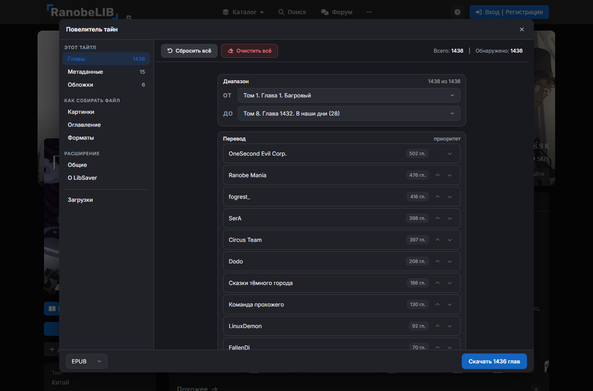
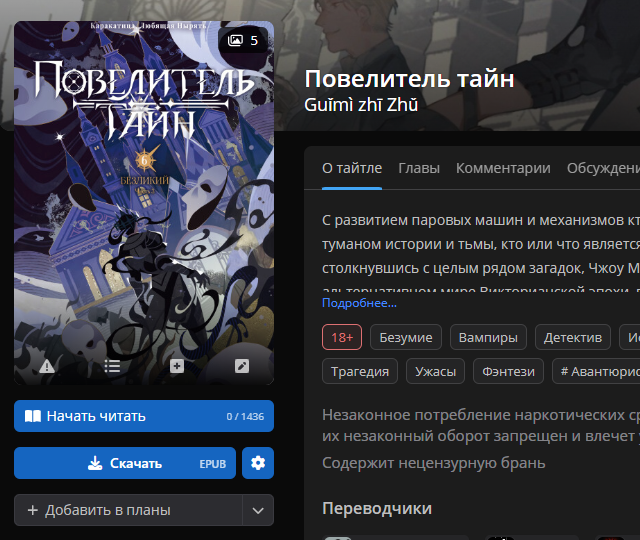
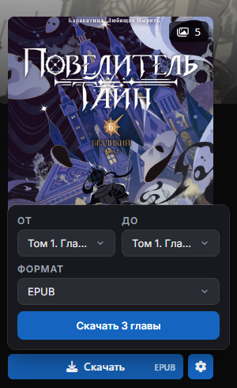
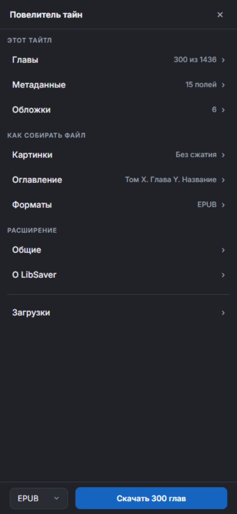
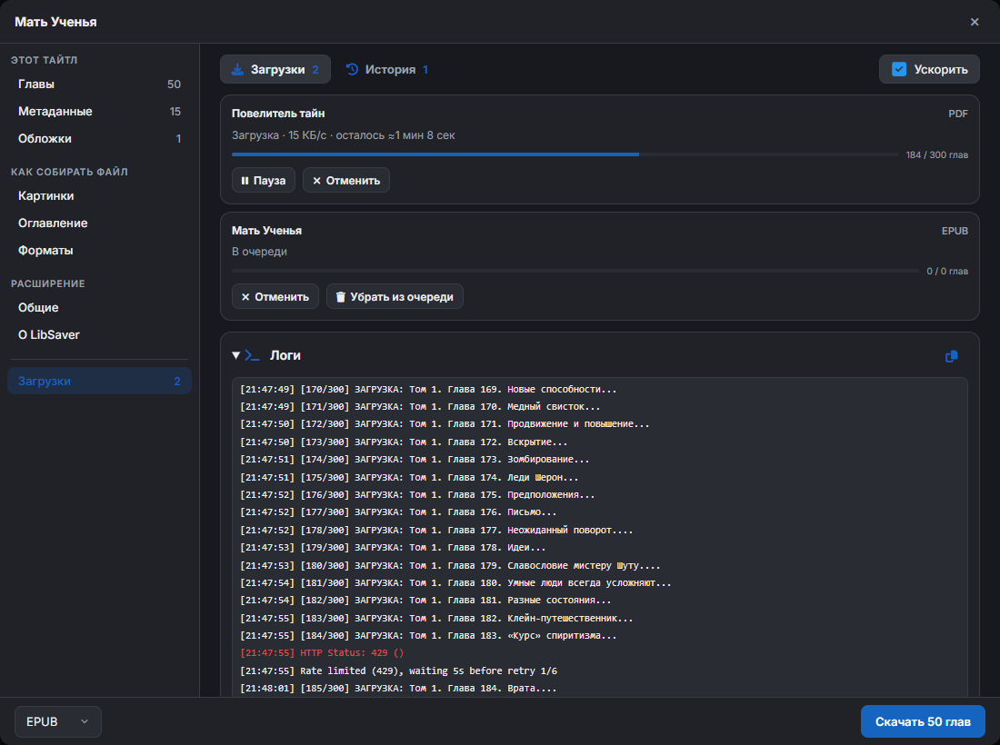
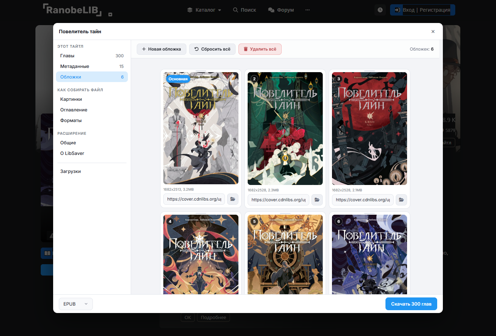

<div align="center">


# LibSaver

**Скачивайте мангу, ранобэ и аниме с LIB-сайтов в один клик**<br>
<sub>Браузерное расширение: кнопка «Скачать» прямо на странице тайтла, файл - в папке загрузок</sub>

<br>

[](https://github.com/dfy-dpg/LibSaver/releases/latest)
[](LICENSE)


<br>

**[⬇️ Скачать последнюю версию](https://github.com/dfy-dpg/LibSaver/releases/latest)** · **[⚙️ Все настройки](SETTINGS.md)** · **[🐞 Сообщить о проблеме](https://github.com/dfy-dpg/LibSaver/issues/new?template=bug_report.yml)**

<br>



</div>

<br>

## ✨ Что умеет

<table>
<tr>
<td width="50%" valign="top">

### 🖱️ Прямо на сайте
Под кнопкой «Начать читать» появляются **«Скачать»** и **⚙**. Быстро выбрали главы и формат - и готово. Нужно тоньше - окно LibSaver открывается поверх сайта.

</td>
<td width="50%" valign="top">

### 🎯 Только нужные главы
Весь тайтл, отдельные тома или конкретные главы. **Приоритет переводчиков** и выбор перевода для каждой главы.

</td>
</tr>
<tr>
<td valign="top">

### 🖼️ Картинки как вам удобно
Исходное качество или сжатие до 1600-480px, конвертация в `JPEG`, `PNG`, `WebP`. Можно выровнять ширину страниц манги.

</td>
<td valign="top">

### 🏷️ Метаданные и обложки
Поля можно переименовать, переставить или убрать. Обложки - с сайта, с компьютера или по ссылке.

</td>
</tr>
<tr>
<td valign="top">

### ⏬ Загрузка в фоне
Очередь из нескольких тайтлов, пауза, повтор и пропуск при ошибках. Окно можно закрыть - загрузка продолжится.

</td>
<td valign="top">

### 🌗 Приятно глазу
Тёмная и светлая тема, цвет подстраивается под сайт. На узком экране окно занимает весь экран.

</td>
</tr>
</table>

## 👀 Как это выглядит

<table>
<tr>
<td align="center" width="33%"><br><sub>Кнопки прямо на странице тайтла</sub></td>
<td align="center" width="33%"><br><sub>Быстрое скачивание в пару кликов</sub></td>
<td align="center" width="33%"><br><sub>Удобно и на узком экране</sub></td>
</tr>
<tr>
<td align="center" colspan="2"><br><sub>Очередь, прогресс и подробный лог</sub></td>
<td align="center"><br><sub>Светлая тема и обложки</sub></td>
</tr>
</table>

## 📚 Форматы

| Формат | 📖 Манга<br><sub>MangaLIB · HentaiLIB · SlashLIB</sub> | 📝 Ранобэ<br><sub>RanobeLIB</sub> | 🎬 Аниме<br><sub>AnimeLIB</sub> | Для чего |
|:--|:-:|:-:|:-:|:--|
| **CBZ / ZIP** | ✅ | | | Основной формат для манги, с `ComicInfo.xml` |
| **EPUB** | ✅ | ✅ | | Основной формат для ранобэ |
| **PDF** | ✅ | ✅ | | Читается везде, есть иероглифы (KR / CN / JP) |
| **HTML** | ✅ | ✅ | | Страница-читалка, открывается в любом браузере |
| **FB2** | | ✅ | | Для читалок, которые любят FB2 |
| **TXT** | | ✅ | | Только текст или текст + картинки в `.zip` |
| **MP4** | | | ✅ | Серии из плеера Kodik со сведениями внутри файла |

> [!WARNING]
> **PDF** собирается долго и ест много памяти: на огромных картинках (5000×5000) браузер может подвиснуть - сожмите картинки до 720-1600px или качайте частями.<br>
> **FB2** плохо переносит много картинок, а читалки могут вылетать на картинках сверхвысокого разрешения - понизьте качество картинок в настройках.

## 📦 Установка

### Chrome, Edge и другие браузеры на Chromium

1. Скачайте архив `LibSaver-v….zip` из [последнего релиза](https://github.com/dfy-dpg/LibSaver/releases/latest) и распакуйте в любую папку.
2. Откройте страницу расширений: `chrome://extensions` (Chrome) или `edge://extensions` (Edge).
3. Включите **«Режим разработчика»**.
4. Нажмите **«Загрузить распакованное расширение»** и выберите распакованную папку.

Готово! 🎉

> [!TIP]
> **Обновление:** когда выйдет новая версия, на иконке расширения появится значок **NEW**. Распакуйте новый архив поверх старой папки и нажмите «Обновить» на странице расширений - настройки сохранятся.

### Firefox (версия 128 и новее)

Если в релизе есть файл `.xpi` - откройте `about:addons` → ⚙ → **«Установить дополнение из файла…»** и выберите его.

<details>
<summary><b>Собрать и подписать под Firefox самому (для разработчиков)</b></summary>

<br>

Для Firefox расширение собирается отдельно: `node tools/build-firefox.cjs` (нужен только Node.js) кладёт сборку в папку `dist/firefox/`. В ней свой манифест: вместо service worker - фоновая страница `engine/background-firefox.html`, в которой работают и фон расширения, и загрузка; нужен Firefox 128 или новее (на Android - Firefox или Firefox Nightly той же версии).

**Проверка без подписи (только на ПК):** `about:debugging` → «Этот Firefox» → «Загрузить временное дополнение…» → файл `dist/firefox/manifest.json`. Временное дополнение пропадает после перезапуска браузера.

**Подпись для постоянной установки.** Firefox ставит насовсем только подписанные расширения. Свои ключи берутся на addons.mozilla.org → Developer Hub → «API keys» (`AMO_JWT_ISSUER` и `AMO_JWT_SECRET`). Подпись (канал `unlisted` - расширение не публикуется в каталоге):

```bash
node tools/build-firefox.cjs
npx web-ext sign --source-dir dist/firefox --channel unlisted --api-key $AMO_JWT_ISSUER --api-secret $AMO_JWT_SECRET
```

Готовый `.xpi` появится в папке `web-ext-artifacts/`. Ключи нигде не сохраняйте и не коммитьте - только переменные окружения.

**Установка на ПК:** `about:addons` → ⚙ → «Установить дополнение из файла…» → выберите `.xpi`.

**Установка на Android:**
1. Скачайте `.xpi` на телефон (или перекиньте файлом).
2. В Firefox для Android включите установку из файла: Настройки → «О Firefox» → пять раз нажмите на логотип (включится меню разработчика), затем Настройки → «Дополнения» → «Установить дополнение из файла». В Firefox Nightly можно вместо этого указать свою коллекцию дополнений («Custom Add-on collection»).
3. Выберите `.xpi` в загрузках телефона и подтвердите установку.

**Что проверить на телефоне** (на тайтле MangaLIB и на тайтле RanobeLIB):
- на странице тайтла есть кнопки «Скачать» и ⚙;
- окно LibSaver открывается на весь экран;
- список разделов → раздел → назад работает;
- скачивание 3 глав проходит, готовый файл появился в загрузках телефона.

> [!NOTE]
> **Статус Android: ещё не проверено.** Результат ручной проверки (что работает, способ установки, версия Firefox) впишите сюда после теста: _не заполнено_.
> Если `downloads.download` на Android не сохраняет файл, планируемое исправление - при ошибке сохранения показывать в разделе «Загрузки» кнопку «Сохранить файл», которая делает `saveAs` из страницы `downloads.html`.

**Доступ к сайтам.** В Firefox (Manifest V3) доступ к сайтам может не выдаваться сам при установке. Если на странице тайтла нет кнопки «Скачать» или загрузка не идёт, откройте `about:addons` → LibSaver → «Разрешения» и включите доступ к сайтам.

**Если фоновая страница засыпает** посреди долгой загрузки (лог в разделе «Загрузки» останавливается), сборку переводят на Manifest V2 с постоянной фоновой страницей: в `tools/build-firefox.cjs` функция `firefoxManifest` отдаёт `manifest_version: 2`, `background: { page, persistent: true }`, `browser_action` вместо `action`, адреса из `host_permissions` - в `permissions`, `web_accessible_resources` - массив строк. Сейчас сборка - Manifest V3.

</details>

## 🚀 Как начать

1. Откройте страницу любого тайтла на поддерживаемом сайте.
2. Нажмите **«Скачать»** под «Начать читать», выберите главы и формат.
3. Файл сам сохранится в папку загрузок браузера. Приятного чтения! 💛

Хотите тонкой настройки - жмите **⚙** рядом с «Скачать». Про каждую галочку подробно рассказано в **[описании настроек](SETTINGS.md)**.

## 📜 Немного истории

Мне нужно было скачать некоторые тайтлы с **RanobeLIB**, но удобное и подходящее для себя решение не нашёл... Решил создать свой инструмент. Так и родилось браузерное расширение **RanobeDL**. А через время была проведена крупная работа над функционалом, дизайном и добавлена поддержка манга-сайтов, так оно переродилось в **LibSaver**.

## 💬 Обратная связь

Нашли ошибку или есть идея - [создайте issue](https://github.com/dfy-dpg/LibSaver/issues/new?template=bug_report.yml), буду рад любой обратной связи!<br>
А если поставите ⭐ - вообще лопну от счастья!!! :*

> [!NOTE]
> На AnimeLIB скачиваются серии из плеера Kodik; собственный плеер AnimeLIB пока не поддерживается.

## 📄 Лицензия

[GPL-3.0](LICENSE)

<div align="center">

<br>

## 💖 Авторы и благодарности

Спасибо всем, кто пользуется **LibSaver**!<br>
Огромное спасибо тем, кто находит ошибки и баги!<br>
И особая благодарность всем участникам **LibSaver**!!!

<br>

<table>
<tr>
<td align="center" width="200">
<a href="https://github.com/dfy-dpg"></a><br>
<a href="https://github.com/dfy-dpg"><b>dfy-dpg</b></a><br>
<sub>оригинальный автор<br><a href="https://github.com/dfy-dpg/LibSaver">dfy-dpg/LibSaver</a></sub>
</td>
<td align="center" width="200">
<a href="https://github.com/Laynholt"></a><br>
<a href="https://github.com/Laynholt"><b>Laynholt</b></a><br>
<sub>автор обновления 2.0.0<br><a href="https://github.com/Laynholt/LibSaver">Laynholt/LibSaver</a></sub>
</td>
</tr>
</table>

<br>

<a href="https://github.com/dfy-dpg/LibSaver/graphs/contributors">
  
</a>

</div>
