

# Настройки LibSaver

Где что находится, что делает каждая галочка и что делать, если что-то пошло не так

> [!NOTE]
> Со временем настройки могут меняться, появляться и даже исчезать. 
> Заметили ошибку или несостыковку, возник вопрос или появилась идея - [сообщите](https://github.com/dfy-dpg/LibSaver/issues/new?template=bug_report.yml)!

## Содержание

| | Раздел | О чём |
|:-:|:--|:--|
| 🧭 | [Где что находится](#где-что-находится) | Кнопки на сайте, окно, плашка, иконка |
| ⚡ | [Быстрое окошко «Скачать»](#быстрое-окошко-скачать) | Скачать в два клика |
| 🪟 | [Окно LibSaver](#окно-libsaver) | Главы, метаданные, обложки и все настройки |
| ⏬ | [Загрузки](#загрузки) | Очередь, прогресс, история, статистика |
| ⚙️ | [Настройки по группам](#настройки-по-группам) | Каждая настройка подробно |
| 📚 | [Форматы файлов](#форматы-файлов) | Что внутри каждого формата |
| 🛟 | [Если что-то пошло не так](#если-что-то-пошло-не-так) | Частые проблемы и решения |

 

## Где что находится

| Где | Что открывается |
|-----|-----------------|
| Кнопка **«Скачать»** под «Начать читать» на странице тайтла | [Быстрое окошко](#быстрое-окошко-скачать): диапазон глав, формат, скачивание |
| Кнопка **⚙** рядом с «Скачать» | [Окно LibSaver](#окно-libsaver) поверх сайта: главы, метаданные, обложки и все настройки |
| **Плашка** в углу страницы (видна, пока идёт загрузка) | Раздел [«Загрузки»](#загрузки) |
| **Иконка расширения** на панели браузера | На странице тайтла - то же окно LibSaver. На других страницах - ссылки на сайты |

> [!TIP]
> - **Кнопки «Сохранить» нет:** настройки сохраняются сами через долю секунды после изменения. Сообщение появится, только если сохранить не удалось. Каждый раздел сохраняет только свои параметры.
> - **У каждой группы настроек есть сброс** - кнопка ↺ в заголовке.
> - **Тема, акцентный цвет и остальные настройки общие** для окна поверх сайта и быстрого окошка.

 

## Быстрое окошко «Скачать»

Открывается по кнопке «Скачать» на странице тайтла и сразу загружает список глав.

- **От** и **До** - диапазон глав. Если в разделе «Главы» окна LibSaver выбраны отдельные главы, окошко покажет этот выбор.
- **Формат** - формат файла. Список зависит от сайта, см. [Форматы файлов](#форматы-файлов).
- **Скачать N глав** - ставит тайтл в очередь загрузки. Окошко можно закрыть - загрузка идёт в фоне.

## Окно LibSaver

Открывается поверх сайта по кнопке ⚙ рядом с «Скачать». Слева меню разделов, справа выбранный раздел, внизу - формат и кнопка скачивания. Закрывается крестиком, клавишей `Esc` или кликом мимо окна - всё, что вы поменяли, уже сохранено.

 

| Группа меню | Раздел | Что там |
|:--|:--|:--|
| **Этот тайтл** | [Главы](#главы) | Диапазон, выбор глав и томов, приоритет переводчиков |
| | [Метаданные](#метаданные) | Поля страницы с информацией о тайтле |
| | [Обложки](#обложки) | Порядок, удаление, свои обложки |
| **Как собирать файл** | Картинки | Группа [«Обработка изображений»](#группа-обработка-изображений) |
| | Оглавление | Группа [«Оглавление»](#группа-оглавление) |
| | Форматы | Группы [«CBZ/ZIP»](#группа-cbzzip), [«PDF»](#группа-pdf), [«TXT»](#группа-txt) |
| **Расширение** | Общие | Группы [«Общие»](#группа-общие) и [«Хранилище»](#группа-хранилище) |
| | О LibSaver | Группа [«О LibSaver»](#группа-о-libsaver) |
| **Отдельный пункт** | Загрузки | [Очередь, история и статистика](#загрузки) |

> [!NOTE]
> **Разделы подстраиваются под сайт.**
> - **Манга** (MangaLIB, HentaiLIB, SlashLIB): есть «Сервер картинок», «Одинаковая ширина страниц», CBZ/ZIP и картинки PDF. Текстовых настроек PDF и группы TXT нет.
> - **Ранобэ** (RanobeLIB): наоборот - есть текст PDF и TXT, а манга-настроек картинок и CBZ/ZIP нет.
> - **Качество и сжатие картинок есть везде:** в ранобэ бывают иллюстрации.
> - **Аниме** (AnimeLIB): вместо картинок, оглавления и форматов - один раздел **Видео** (группа [«Видео»](#группа-видео)), а «Главы» называются «Серии» (том - сезон).
>
> **«Форматы»** показывают настройки всех форматов этого сайта сразу, какой бы формат ни был выбран внизу: их можно поправить заранее.

**📱 На телефоне** (узкий экран) окно занимает весь экран, а меню - отдельный список с подписями: сколько глав выбрано, какой формат и т.д.

**Низ окна:**
- **Формат** - формат файла для этого тайтла.
- **Скачать N глав** - ставит тайтл в очередь с текущим выбором глав, формата и настроек. Пока тайтл в очереди или качается, второй раз он не встанет; в другом формате его можно поставить, когда загрузка закончится.

### Главы

- **Диапазон** («От» и «До») и **выбор нужных глав** - можно быстро снять и выделить все главы тома, а также выбрать отдельные главы.
- **Приоритет перевода** (справа от кнопки «Очистить всё») - порядок переводчиков: тот, что выше, приоритетнее. Для каждой главы берётся первый доступный перевод из списка.
- **Перевод отдельной главы** - напротив главы можно выбрать конкретный перевод (если там пусто - у главы всего один перевод).
- **Поиск:** номер (`12`), диапазон (`10-20`) или часть названия. «Только выбранные» оставляет в списке отмеченные главы. Найденные можно разом **отметить** или **снять**.
- **Выбрать новые** - LibSaver помнит главы, скачанные целиком (по тому и номеру, перевод не важен), и одной кнопкой отмечает остальные. Главы, где пропустили картинку или саму главу, скачанными не считаются.
- **Список показывается частями:** сначала 100 глав, внизу кнопки «Показать ещё (100)» и «Показать все». Сколько глав в части - в группе [«Общие»](#группа-общие).

🖼️ <b>Скриншот: тома и главы</b>

 
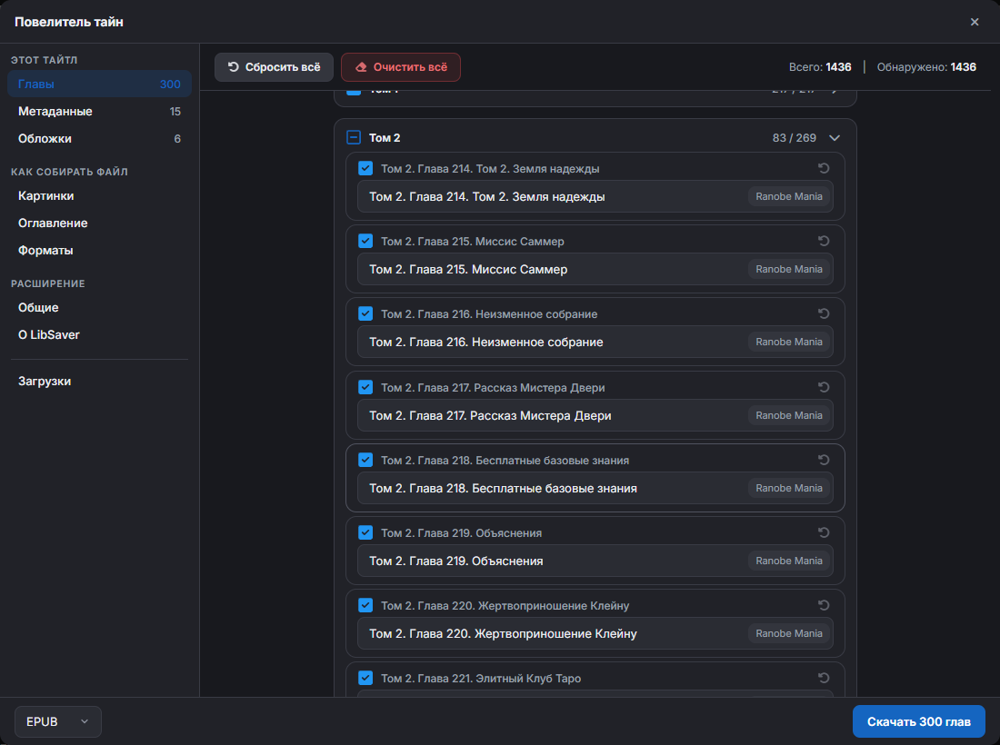

### Метаданные

Поля можно **переименовывать**, **перемещать** и **отключать** - всё это влияет на страницу с метаданными в готовом файле.

- Поле **пустое** или **отключено** - оно не попадёт в файл.
- Все поля пустые или отключены - страницы с метаданными не будет.
- Число в меню - сколько полей включено.

🖼️ <b>Скриншот</b>

 
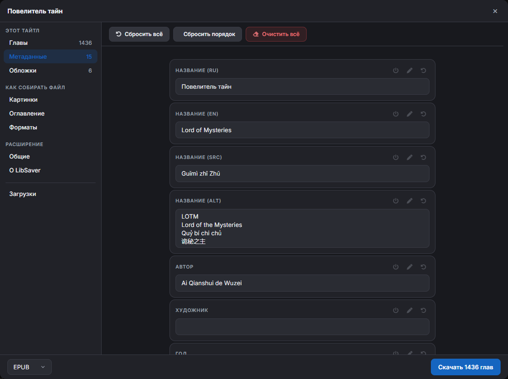

### Обложки

Ползунок справа вверху меняет вид: «Список», «5 в ряд» … «2 в ряд». В списке наведите на миниатюру - обложка покажется крупнее.

Обложки можно **перетаскивать** (порядок), **удалять**, **загружать с компьютера** или **по URL** (хоть с самих LIB-сайтов, хоть из интернета). Первая обложка - главная.

> [!WARNING]
> Обложки обычно загружаются с сайта, но встречаются тайтлы, которые их **не отдают** - будьте внимательны!

🖼️ <b>Скриншот</b>

 
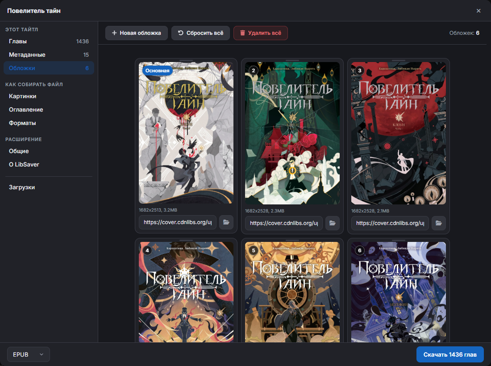

## Загрузки

### 📥 Очередь

- **Качается один тайтл, остальные ждут.** Несколько тайтлов встают в очередь и качаются по одному.
- **Очередь живёт в фоне расширения** - окно и даже вкладку сайта можно закрыть.
- **Нужна открытая вкладка сайта:** картинки и главы запрашиваются через страницу сайта. Если открытых вкладок сайта нет, загрузка ждёт - плашка напишет «Откройте страницу …, чтобы продолжить». Откройте любую страницу нужного сайта, и загрузка продолжится сама.

### 📊 Ход загрузки

Считается по страницам: процент и полоска двигаются с каждой скачанной картинкой главы, а не только после целой главы. Он виден:
- на кнопке «Скачать» этого тайтла (заливка и «45%»);
- в **плашке**: процент, примерное оставшееся время и сколько тайтлов ждёт в очереди, плюс полоска по нижнему краю;
- в разделе «Загрузки».

Плашку можно **перетащить в любой угол** - угол запоминается для всех вкладок. Клик по плашке открывает раздел «Загрузки».

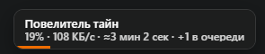

### 🎛️ Управление

| Что | Где и как работает |
|:--|:--|
| **Пауза**, **Отмена** | Кнопки на карточке тайтла в разделе «Загрузки» |
| **Повторить** / **Пропустить** | Появляются, если не скачалась глава или картинка |
| **Ускорить** | Галочка вверху раздела. Подробнее - [ниже](#ускорить) |
| **Логи** | Под списком; подробнее - с «[Подробным логированием](#группа-общие)». Кнопкой 📋 лог копируется целиком |
| **Загрузки \| История** | Вкладки вверху раздела. На «Загрузках» - тайтлы в работе и в очереди, лог и статистика; в «Истории» - готовые, отменённые и упавшие. Рядом с названием - сколько в ней тайтлов |
| **Очистить историю** | Кнопка на вкладке «История»: разом убирает все готовые, отменённые и упавшие тайтлы. Тайтлы в работе и в очереди не трогает |
| **Сохранить файл ещё раз** | Кнопка у последнего готового тайтла: сохраняет файл заново без повторной загрузки. В памяти держится только последний готовый файл |

**Готовый файл** сохраняется сам в папку загрузок браузера. Чтобы скачать тайтл в другом формате или с другими настройками, поменяйте их и снова нажмите «Скачать N глав».

🖼️ <b>Скриншот: вкладка «История»</b>

 
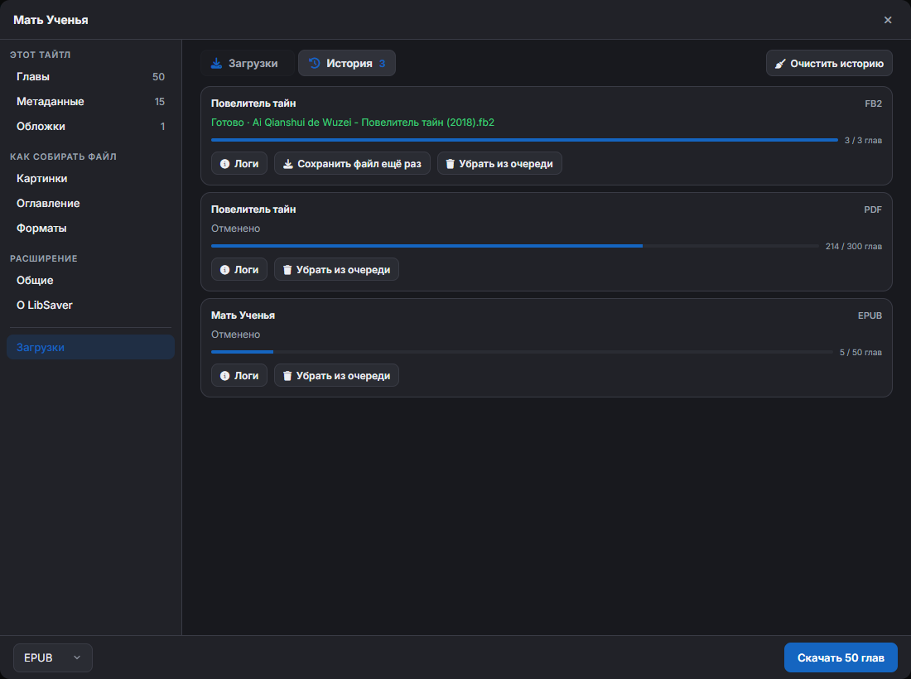

### Ускорить

**По умолчанию включено.** Без пауз и без ограничения запросов в минуту: главы и картинки качаются на полной скорости, картинки - по 3 сразу.

Если снять, запросы глав и картинок ограничиваются 60-90 в минуту, а между ними появляются случайные паузы. Пригодится, если сайт отвечает ошибками на частые запросы (обычно на длинных тайтлах).

Ставить и снимать можно прямо во время загрузки - подействует сразу. Подсказка с этим описанием - при наведении на галочку.

### Статистика

📈 <b>Что значит каждая строка</b>

 

| Строка | Что значит |
|--------|------------|
| Время загрузки | Сколько идёт загрузка |
| Примерное время | Сколько осталось. Считается по скорости за последнюю минуту, поэтому после паузы или ожидания решения по ошибке сначала растёт, а через минуту снова точная. Первые секунды - «Вычисляется...» |
| Размер файла | Размер скачанного; после сборки - точный размер файла |
| Ошибки | Ошибки глав и картинок |
| Главы старого формата | Главы ранобэ старого формата (в PDF картинки таких глав могут оказаться в начале главы). У манги строки нет |
| Пропущено глав / картинок | Что вы пропустили при ошибках |
| Загружено глав / обложек / картинок | Что попало в файл |
| Запросов в минуту | Текущая скорость и в скобках - её предел. Скорость подстраивается сама: снижается при ошибках сайта и растёт, когда всё спокойно |

## Настройки по группам

### Группа «Общие»

🖼️ <b>Скриншот</b>

 
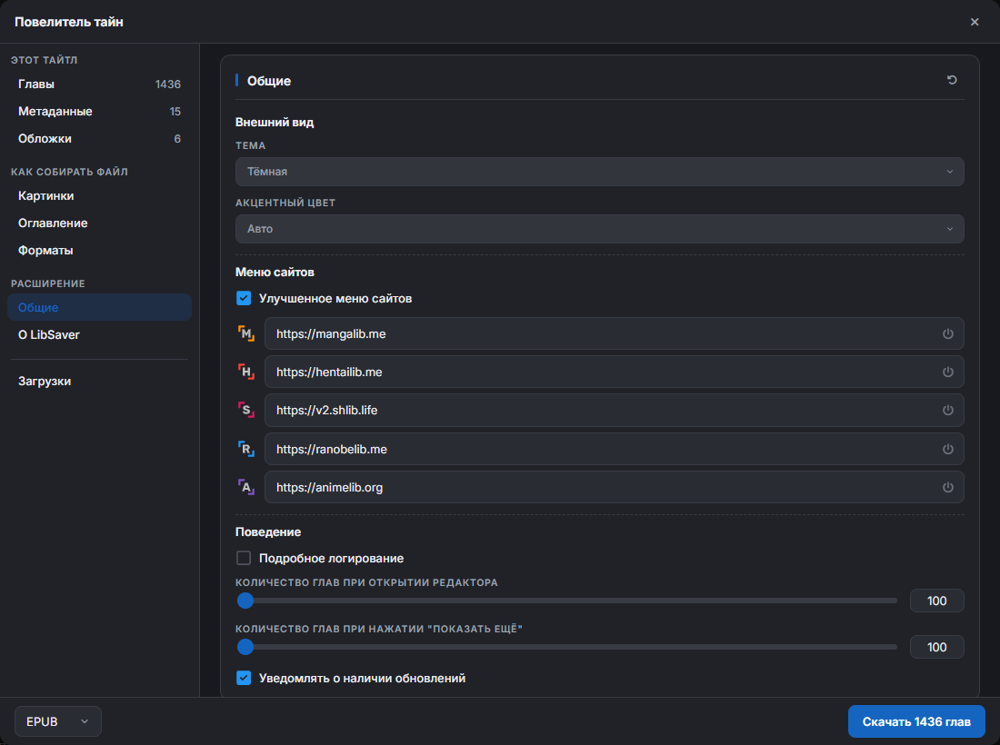

#### 🎨 Внешний вид

| Настройка | Что делает |
|:--|:--|
| **Тема** | Тёмная, светлая или системная |
| **Акцентный цвет** | «Авто» берёт цвет сайта, на котором вы открыли LibSaver; можно выбрать и постоянный цвет |

#### 🧭 Меню сайтов

**Улучшенное меню сайтов** - добавляет, убирает, меняет порядок и ссылки сайтов в меню возле логотипа на LIB-сайтах. Ссылку каждого сайта можно поменять (например, на зеркало) или выключить кнопкой ⏻.

🖼️ <b>Как меню выглядит, если настройка выключена</b> (пользователь не зарегистрирован)

 

||||
|--|--|--|

🖼️ <b>Как меню выглядит, если настройка включена</b> (пользователь не зарегистрирован)

 

||||
|--|--|--|

#### 🔧 Поведение

| Настройка | Что делает |
|:--|:--|
| **Подробное логирование** | Больше строк в логе загрузки: исходная картинка, сжатие и конвертация, выбранный и попавший в файл перевод |
| **Количество глав при открытии редактора** | 100-1000, по умолчанию 100 - сколько глав видно сразу в разделе «Главы» |
| **Количество глав при нажатии «Показать ещё»** | 100-1000, по умолчанию 100 - сколько добавляется за раз |
| **Уведомлять о наличии обновлений** | Раз в 6 часов проверяет последний релиз на GitHub. Подробнее - ниже |

Раздел «Главы» всегда показывает главы частями: тысячи карточек разом надолго вешают окно.

**🔔 Если вышла новая версия** (при включённых уведомлениях):
- на иконке расширения появляется значок **NEW**, а подсказка у иконки называет версию;
- в шапке окна LibSaver на сайте появляется зелёная кнопка **«vX.Y.Z»**, которая скачивает обновление;
- окошко иконки расширения показывает уведомление.

Без галочки расширение не проверяет обновления и значок пропадает. Само обновление не ставится: архив нужно распаковать вместо старой папки и нажать «Обновить» на странице расширений.

### Группа «Хранилище»

Находится в разделе «Общие».

| Настройка | Что делает |
|:--|:--|
| **Очищать данные при смене тайтла** | При переходе к другому тайтлу удаляются сохранённые данные прежнего (главы, метаданные, обложки). Данные, обновлённые меньше часа назад, остаются - чтобы не мешать тайтлу, открытому в соседней вкладке |
| **Очищать данные старше 7 дней** | Удаляет данные тайтлов, которые не открывали неделю |
| **Занято в хранилище** | Сколько места занимают данные расширения. **Очистить старые данные** удаляет данные всех тайтлов, кроме открытого |
| **Резервная копия настроек** | **Экспорт** сохраняет все настройки и профили в JSON-файл, **Импорт** заменяет ими текущие. Тайтлы, обложки и история в файл не попадают |

### Группа «Обработка изображений»

В меню окна LibSaver - раздел «Картинки».

🖼️ <b>Скриншот</b>

 
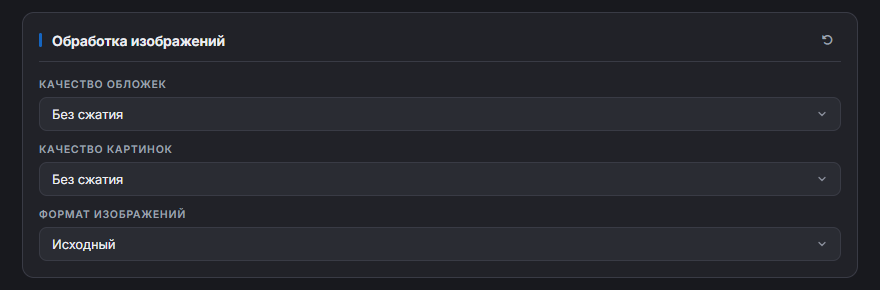

| Настройка | Варианты |
|:--|:--|
| **Качество обложек** не касается картинок внутри глав | **Без обложек** - в файле не будет обложек **Без сжатия** - обложки в исходном качестве **От 1600px до 480px** - сжимает одну из сторон обложки (см. «Метод сжатия») до указанного значения |
| **Качество картинок** не касается обложек | **Без картинок** - в файле не будет картинок **Без сжатия** - картинки в исходном качестве **От 1600px до 480px** - сжимает одну из сторон картинки до указанного значения |
| **Сервер картинок** MangaLIB, HentaiLIB, SlashLIB | **Сжатые** (по умолчанию) - те же страницы того же размера со второго сервера, уже после сжатия (`JPEG` или `PNG`): файл легче, сервер надёжнее, качество чуть ниже оригиналов **Оригиналы** - картинки как их залили (часто `PNG`, бывают и _специфичные_ форматы). Если оригинал недоступен, расширение само возьмёт сжатые и напишет об этом в логе |
| **Метод сжатия** при качестве 1600px-480px | По меньшей стороне, по большей стороне или адаптивный |
| **Порог соотношения сторон** для адаптивного метода | От 2:1 до 5:1 |
| **Формат изображений** все форматы, кроме PDF - у него свой | **Исходный** - картинки и обложки в формате, который отдаёт сайт **`JPEG`, `PNG` или `WebP`** - всё остальное конвертируется в выбранный формат |
| **Качество JPEG / WebP** при `JPEG` или `WebP` | От 0.1 до 1: чем меньше, тем легче файл и хуже картинка |
| **Одинаковая ширина страниц** манга, по умолчанию выключено | Все страницы приводятся к самой частой ширине страниц первой главы - широкие ужимаются, узкие растягиваются, пропорции сохраняются. Обложки не трогаются. Работает во всех форматах; сжатие по качеству считается уже от новой ширины |

> [!CAUTION]
> С форматом «Исходный» сайт может отдавать _специфичные_ форматы: `AVIF`, `GIF` и другие! 
> Убедитесь, что ваша читалка их поддерживает, иначе выберите конвертацию в `JPEG` или `PNG`.

📐 <b>Методы сжатия: таблица</b>

 

| Метод | Описание | Когда использовать |
|-------|----------|-------------------|
| По меньшей стороне | Изображение сжимается так, чтобы меньшая сторона не превышала заданный размер. | Для большинства изображений: баланс между размером и качеством. |
| По большей стороне | Изображение сжимается так, чтобы большая сторона не превышала заданный размер. Пропорции сохраняются. | Когда нужен минимальный размер файла. |
| Адаптивный | Если изображение слишком вытянутое (соотношение сторон не меньше порога, например 3:1), сжатие не применяется. Иначе работает как «По меньшей стороне». | Чтобы не испортить длинные вертикальные страницы и сжать обычные. |

🧮 <b>Методы сжатия: примеры</b>

 

**Метод «По меньшей стороне» (Качество: 1080px)**
- 2000×1500 → 1440×1080 (меньшая сторона 1500 > 1080 → **сжимаем**)
- 2000×2000 → 1080×1080 (меньшая сторона 2000 > 1080 → **сжимаем**)
- 1920×1080 → 1920×1080 (меньшая сторона 1080 = 1080 → **оставляем**)
- 1280×720 → 1280×720 (меньшая сторона 720 < 1080 → **оставляем**)
- 1500×2000 → 1080×1440 (меньшая сторона 1500 > 1080 → **сжимаем**)

**Метод «По большей стороне» (Качество: 1080px)**
- 2000×1500 → 1080×810 (большая сторона 2000 > 1080 → **сжимаем**)
- 2000×2000 → 1080×1080 (большая сторона 2000 > 1080 → **сжимаем**)
- 1080×720 → 1080×720 (большая сторона 1080 = 1080 → **оставляем**)
- 960×540 → 960×540 (большая сторона 960 < 1080 → **оставляем**)
- 1500×2000 → 810×1080 (большая сторона 2000 > 1080 → **сжимаем**)

**Адаптивный метод (Качество: 1080px, Порог: 3 к 1)**
- 4000×1200 → 4000×1200 (соотношение 3.3:1 ≥ 3:1 → **оставляем**)
- 3000×1000 → 3000×1000 (соотношение 3:1 = 3:1 → **оставляем**)
- 1280×720 → 1280×720 (соотношение 1.7:1 < 3:1 → меньшая 720 < 1080 → **оставляем**)
- 2000×1500 → 1440×1080 (соотношение 1.3:1 < 3:1 → меньшая 1500 > 1080 → **сжимаем**)
- 1200×4000 → 1200×4000 (соотношение 3.3:1 ≥ 3:1 → **оставляем**)

### Группа «Оглавление»

🖼️ <b>Скриншот</b>

 
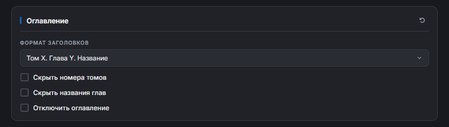

| Настройка | Что делает |
|:--|:--|
| **Формат заголовков** | Какими будут заголовки глав - варианты ниже |
| **Скрыть номера томов** | Убирает «Том X» из готовых форматов |
| **Скрыть названия глав** | Убирает название главы из готовых форматов |
| **Отключить оглавление** | Файл без оглавления во всех форматах |

**Варианты формата заголовков:**
- Том X Глава Y Название
- Том X Глава Y - Название
- Том X - Глава Y - Название
- Том X / Глава Y / Название
- Том X. Глава Y. Название
- варианты без названия (если стоит «Скрыть названия глав»), без тома (если стоит «Скрыть номера томов») или только «Глава Y» (обе галочки)
- Без заголовков
- **Пользовательский формат** - свои подписи вокруг тома `{vol}`, главы `{num}` и названия `{name}`; галочки скрытия на него не влияют

Новый формат заголовков применяется, когда вы закончили правку (выбрали вариант или ушли из поля пользовательского формата), а не на каждую набранную букву.

✍️ <b>Примеры пользовательского формата</b>

 

| На сайте | Ввели | Получили |
|:--|:--|:--|
| Том 1 Глава 0 - Пролог | `Т.{vol}, Г.{num}` | Т.1, Г.0 |
| Том 9 Глава 2 - Это любовь?! | `{vol}-{num}-{name}` | 9-2-Это любовь?! |
| Том 1 Глава 22 | `Глава {num} - {name}` | Глава 22 - |
| Том 1 Глава 22 | `[Глава {num}] - [{name}]` | Глава 22 |

> [!IMPORTANT]
> У главы на сайте может не быть названия - тогда получится что-то вроде «Глава 22 - ». 
> Для этого есть **секции**: всё, что в квадратных скобках, пропадает вместе с пустым значением внутри. 
> **Пользовательский формат**: `! [Том {vol}] @ [Глава {num}] # [{name}] $` 
> **Глава с названием**: «! Том 4 @ Глава 31 # Ёрико $» 
> **Глава без названия**: «! Том 4 @ Глава 31 $» 
> Готовые форматы это учитывают сами.

### Профили скачивания

Находятся в разделах «Форматы» и «Видео». Профиль - это формат файла и все настройки сборки (картинки, оглавление, CBZ, PDF, TXT, видео, разбивка). Настройте всё как нужно, впишите название («Манга для читалки») и нажмите **Сохранить**. **Применить** возвращает настройки профиля одним нажатием.

### Разбивка на файлы

Находится в разделе «Форматы». **Глав в одном файле**: 0 - один файл на тайтл; например 100 - тайтл из 350 глав сохранится четырьмя файлами «Тайтл - 1 (1-100).epub» … «Тайтл - 4 (301-350).epub». Удобно для телефонов и читалок, которые не открывают большие файлы. «Сохранить ещё раз» у такой загрузки недоступна - скачайте её снова.

### Группа «CBZ/ZIP»

Влияет только на `CBZ/ZIP`.

- **ComicInfo.xml** - файл метаданных, который понимают читалки комиксов.

### Группа «PDF»

Влияет только на `PDF`.

🖼️ <b>Скриншот</b>

 
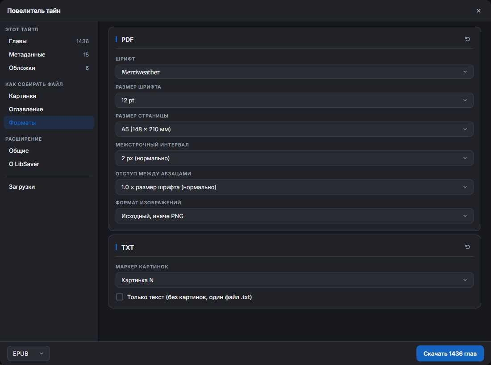

| Настройка | Что делает |
|:--|:--|
| **Шрифт** | Пять с засечками и пять без. Шрифт встраивается в файл целиком. Иероглифы - см. ниже |
| **Размер шрифта** | От 6pt до 20pt |
| **Размер страницы** | A6, A5, A4, Letter, B5, B4. На картинки не влияет: для каждой картинки создаётся страница её размера |
| **Межстрочный интервал** | От 0px до 5px |
| **Отступ между абзацами** | От 0.5 до 2.0, умножается на размер шрифта |
| **Формат изображений** | **Исходный, иначе `PNG`** - `JPEG` и `PNG` остаются как есть, остальное конвертируется в `PNG` **Исходный, иначе `JPEG`** - `JPEG` и `PNG` остаются как есть, остальное конвертируется в `JPEG` с выбранным качеством |
| **Качество JPEG** | От 0.1 до 1 |

**🈶 Иероглифы.** Корейского, китайского и японского в основных шрифтах нет: такие символы рисуются запасными шрифтами - корейский NanumGothic, китайский и японский Droid Sans Fallback. Каждый добавляется в PDF (около 2 МБ), только если его символы встретились.

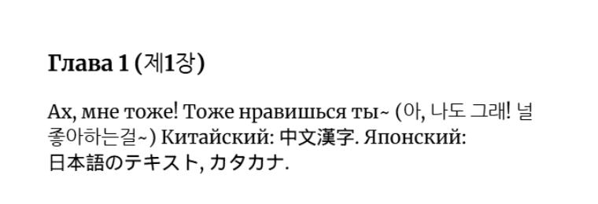

### Группа «TXT»

Влияет только на `TXT`.

| Настройка | Что делает |
|:--|:--|
| **Маркер картинок** | Надпись на месте картинки: «Картинка N», «Картинка» или без маркера |
| **Только текст** | Один обычный `.txt` без обложек и картинок. Без галочки получится `.zip` с папками «Обложки», «Картинки» и `.txt` |

### Группа «Видео»

Только AnimeLIB. Серии качаются из плеера Kodik в `MP4` (H.264 + AAC, без перекодирования) и складываются в папку тайтла в загрузках: `Название - S01E01.mp4`.

Серия качается частями в 8 потоков (сервер Kodik медленно отдаёт одно соединение), затем сохраняется в загрузки браузера. Ход серии виден в списке загрузок LibSaver.

| Настройка | Что делает |
|:--|:--|
| **Качество серий** | «Наилучшее», 1080p, 720p, 480p или 360p. Если такого нет - берётся ближайшее ниже, а если все выше - наименьшее из имеющихся |
| **Сведения в самом MP4** | В каждую серию вписываются название серии, тайтл, сезон и номер, год, жанры, описание, в комментарий - студия, метки, возраст и оценка Shikimori. Их видят проводник Windows, VLC, Jellyfin, Plex |
| **Описание тайтла текстом** | Рядом с сериями `Описание.txt`: названия, год, статус, возраст, студия, жанры, метки, оценка Shikimori и описание. Открывается в Блокноте |
| **Обложка тайтла** | Рядом с сериями `poster.jpg` |

> [!NOTE]
> **Озвучка:** у каждой серии берётся плеер Kodik выбранного в «Сериях» перевода, а если его у серии нет - первый Kodik серии. Серии только с собственным плеером AnimeLIB (без Kodik) пропускаются с записью в журнал.

### Группа «О LibSaver»

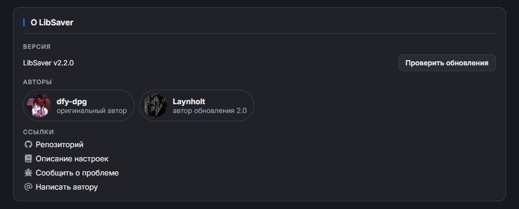

- **Версия** и **Проверить обновления** - сравнивает версию расширения с последним релизом на GitHub. Если есть новее, надпись станет «vA → vB · скачать»: по клику в Chrome скачается архив релиза и откроется страница релиза (распакуйте архив поверх папки расширения и нажмите «Обновить» на `chrome://extensions`), в Firefox откроется подписанный `.xpi` - браузер предложит его установить.
- **Авторы** - оригинальный автор и автор обновления 2.0.
- **Ссылки** - репозиторий, это описание настроек, **Сообщить о проблеме** (форма на GitHub, где версия, страница тайтла и браузер уже заполнены) и почта автора.

## Форматы файлов

| Формат | Сайты | Что внутри | Заметки |
|--------|-------|------------|---------|
| **EPUB** | все, кроме AnimeLIB | обложки, метаданные, оглавление, главы с картинками | Основной формат для ранобэ |
| **FB2** | RanobeLIB | обложки, метаданные, оглавление, главы | Хуже справляется с картинками |
| **TXT** | RanobeLIB | метаданные, текст глав; с картинками - `.zip` | См. группу [«TXT»](#группа-txt) |
| **CBZ/ZIP** | MangaLIB, HentaiLIB, SlashLIB | обложки, страницы глав, ComicInfo.xml | Основной формат для манги |
| **PDF** | все, кроме AnimeLIB | обложки, главы | **Очень требовательный!** Для большого тайтла лучше сжатие картинок до 720px-1600px или скачивание частями |
| **HTML** | все, кроме AnimeLIB | страница-читалка с оглавлением; картинки - рядом в архиве | Открывается в любом браузере |
| **MP4** | AnimeLIB | серии со сведениями внутри, `Описание.txt` и обложка в папке тайтла | См. группу [«Видео»](#группа-видео) |

## Если что-то пошло не так

| Что случилось | Что сделать |
|:--|:--|
| Плашка пишет «Откройте страницу …, чтобы продолжить» | Откройте любую страницу нужного сайта - загрузка продолжится сама |
| Сайт не открывается (например, animelib.org) | LibSaver сам ищет рабочее зеркало (v1…v9: `v5.animelib.org`) и переводит вкладку на него; меню сайтов и ссылки в «Загрузках» тоже ведут на зеркало |
| Сайт отвечает ошибками на частые запросы | Снимите галочку [«Ускорить»](#ускорить) - запросы станут реже |
| Не скачалась глава или картинка | В разделе «Загрузки» нажмите **Повторить** или **Пропустить** |
| Готовый файл не сохранился | **Сохранить файл ещё раз** у последнего готового тайтла в «Истории» |
| PDF собирается очень долго или браузер подвисает | Сожмите картинки до 720px-1600px или качайте тайтл частями |
| Читалка вылетает на FB2 с картинками | Понизьте [качество картинок](#группа-обработка-изображений); для тайтлов с большим количеством картинок FB2 лучше не брать |
| Читалка не показывает картинки | Включите конвертацию [формата изображений](#группа-обработка-изображений) в `JPEG` или `PNG` |
| В файле нет обложек | Сайт мог их не отдать - добавьте свои в разделе [«Обложки»](#обложки) |
| Firefox: на странице тайтла нет кнопки «Скачать» | `about:addons` → LibSaver → «Разрешения» → включите доступ к сайтам |
| Ничего не помогло | [Сообщите о проблеме](https://github.com/dfy-dpg/LibSaver/issues/new?template=bug_report.yml) и приложите лог (кнопка 📋 у «Логов») |

 

**[⬅️ Назад к README](README.md)** · **[⬇️ Последний релиз](https://github.com/dfy-dpg/LibSaver/releases/latest)**

